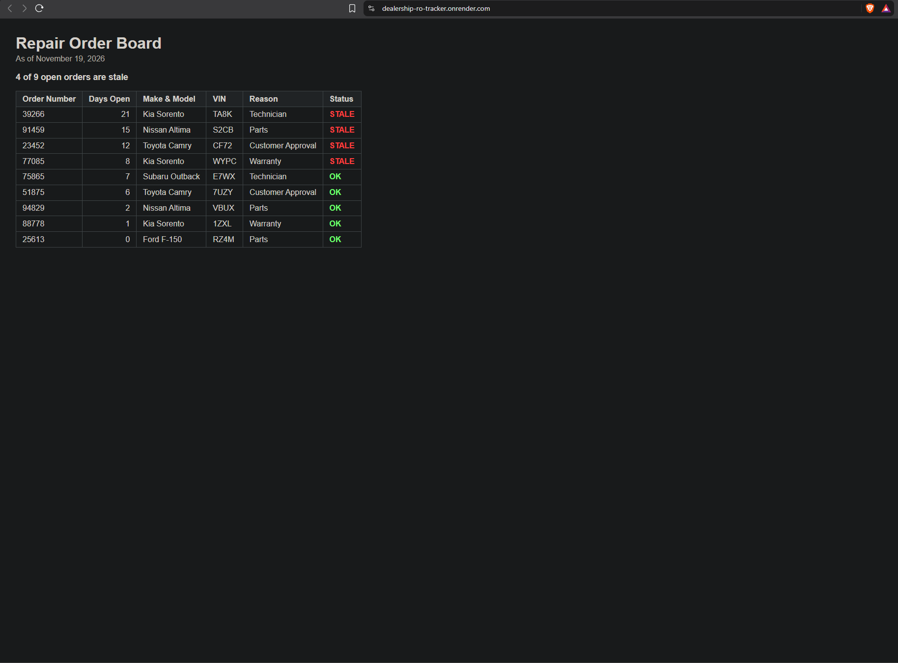

### Screenshot of the app in action

### About the app

This app is a portfolio project that was created using synthetic data. It exists to serve one hypothetical user, a service manager at a car dealership named Mr. Smith. Mr. Smith keeps track of his dealership's shop's backlog of repair orders on a whiteboard in his office. This app is meant to replace his whiteboard and make his goal of determining which repair orders have been around for too long easier to accomplish and more concrete.

### Link

Here is a link to the webpage of the app: https://dealership-ro-tracker.onrender.com/  
Note: I am using a free hosting option; the webpage takes about 50 seconds to load from idle.

### How it works

Data Generator -> CSV -> Loader -> Database -> Flask page

This app works by first loading a data generation script, which creates synthetic data that simulates the information Mr. Smith would have on his whiteboard. This data generation script is a stand-in for an actual customer data feed that would exist in a real world car dealership scenario. The data generation script stores the data in CSVs and then a loader loads the data from the CSVs into a database. Finally the data stored in the database is loaded to the webpage by Flask. The data is generated on start and not on build so that it doesn't artificially age. A key component of this app is to determine whether a repair order is stale or not. An order is defined to be "STALE" if it has not been completed for more than 7 days since the date it was opened. This is why the data must be generated on start, the app calculates how old an order is not based on fixed dates, but relative to today's date.

### Run it

These are the Windows commands I've been using to run this on my machine, using Python 3:

1\. Install Git and Python 3 (Tested on 3.14 and 3.15).

2\. Open a Windows terminal wherever you keep projects (Avoid OneDrive-synced folders).

3\. Clone the repository and step into the folder (git clone https://github.com/jordanrose2401/dealership-ro-tracker.git

cd dealership-ro-tracker).

4\. Create a virtual environment (py -m venv .venv).

5\. Activate the virtual environment (.venv\\Scripts\\Activate.ps1). If PowerShell says running scripts is disabled, you can use Command Prompt and run .venv\\Scripts\\activate.bat instead.

6\. Install requirements.txt (pip install -r requirements.txt). Note: Gunicorn is skipped on Windows (skipped line during install isn't an error), and data\\ and orders.db\\ are created by the scripts.

7\. Generate data (python scripts\\data\_gen.py).

8\. Load data (python scripts\\load\_orders.py data\\good\_orders.csv).

9\. Test (python -m unittest). You should see "Ran 6 tests" and "OK."

10\. Run (python app.py).

11\. View (visit http://127.0.0.1:5000/ in your browser). You should see a table with today's date at the top and the statement "4 of 9 open orders are stale."

12\. Quit (CTRL+C).

### Security Decisions

Read SECURITY\_REVIEW.md to see my review of the app's security. Some important security notes: the app never stores actual customer information (names, phone numbers, addresses) and only the last 4 characters of the VIN are known by the app. The database is opened read-only so the page can't change data even if something goes wrong. Every CSV row is checked by the loader, then the database enforces its own rules, providing some redundancy. The page accepts no input, and errors are displayed in plain messages while detailed error codes stay in logs. There are no secrets in the app or repository, dependencies are pinned in requirements.txt, and pip-audit returned no vulnerabilities when I ran it on November 20, 2026. Furthermore, my GitHub has 2FA enabled adding further security since the only way to modify the data is to have login access to my repository. Finally there is no login, this is intended and deemed acceptable for this app using synthetic data.

### Real version

A real version of this app would need a company sign-in, an actual data feed that would link order numbers to customer records in the dealership's own system (only the columns the app needs), hosting inside the company's boundary instead of using free hosting through Render, and a review under the company's standards.

### How I built it

Claude wrote all code from prompts which I revised with input from Claude chat. I wrote the intake sheet and design documents, also with revisions based on input from Claude chat. I reviewed every plan generated by Claude Code and manually ran the scripts which Claude Code generated. I did the securrity review with feedback from Claude chat, and ran pip-audit to check for vulnerabilities.

### Known limitations

The data is synthetic, and the live site sleeps when idle. There is no login, no user input is accepted, and the data only refreshes upon app restart. Staleness is calculated using calendar days in Utah time (America/Denver) set through the host's TZ (timezone) setting. Finally, requirements.txt is edited by hand, beacause generating it by hand would drop the Gunicorn line.

